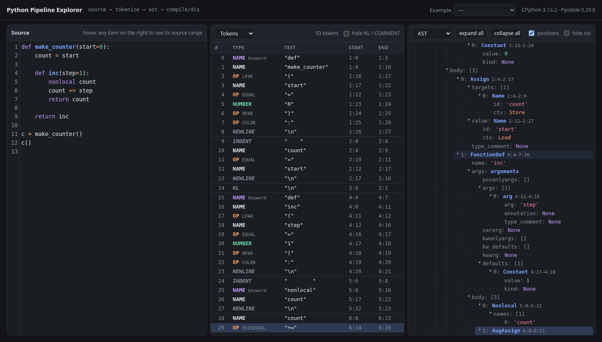

# Python Pipeline Explorer

See how CPython reads your code. Type Python on the left and watch it become **tokens**, an **abstract syntax tree**, and **bytecode**, all produced live in your browser by real CPython.



```
source ──▶ tokenize ──▶ ast ──▶ compile / dis
           (scanner)   (parser)  (bytecode)
```

It started as a companion to [*Crafting Interpreters*](https://craftinginterpreters.com/). After reading how CPython's scanner (`Parser/lexer/`) and PEG parser (`Grammar/python.gram`) work, I wanted to watch each stage happen to real code.

## Features

- **Three linked views.** The source editor is always on the left, and each of the other two panes can show Tokens, AST or Bytecode.
- **Source linking in both directions.** Hover a token, AST node or instruction and its exact source span lights up. Move the editor cursor and the matching items are highlighted in every pane: the closest match strongly, anything containing it faintly. Click an item to select its source.
- **Tokens** come from `tokenize`, including the structural tokens your eyes skip: `NEWLINE`, `NL`, `INDENT`, `DEDENT`, `ENDMARKER`. Operators show their exact type (`OP PLUS`), keywords and soft keywords (`match`, `case`, `_`, `type`) are marked, and f-strings break into `FSTRING_START` / `MIDDLE` / `END`.
- **AST** comes from `ast.parse`, as a collapsible tree with source positions for every node. It has expand all / collapse all and an option to hide the `ctx` noise.
- **Bytecode** comes from `compile` + `dis`, with one section per code object (module, functions, nested closures, generator expressions). Each section lists its locals, cell and free variables, names and constants. Jump targets are labelled and opcodes are coloured by kind.
- **Errors are data, not crashes.** Syntax errors are underlined in the editor, the tokens produced before the failure still show, and compiler `SyntaxWarning`s appear too.
- **Built-in examples:** expressions, control flow, closures, classes, comprehensions, f-strings, `match`, `try` / `with`, and a deliberately broken one.
- Resizable columns, light and dark themes that follow your system, and your source, panes and widths are remembered.

## Running it

It's a static site with no build step and no dependencies to install. It must be served over HTTP, because opening `index.html` as a `file://` URL won't load.

```bash
git clone https://github.com/<you>/py-explorer.git
cd py-explorer
python3 -m http.server 8000
# open http://localhost:8000
```

The first load downloads about 10 MB of CPython-on-WebAssembly from the jsDelivr CDN and takes a few seconds. After that the browser caches it.

### Deploying to GitHub Pages

Everything is static, so Pages works as-is: **Settings → Pages → Deploy from a branch → `main` / root**.

## How it works

```
index.html                          analyze.py (runs inside Pyodide)
┌─────────────────────────┐  src   ┌───────────────────────────────────┐
│ CodeMirror editor       │ ─────▶ │ tokenize.generate_tokens(...)     │
│   (300 ms debounce)     │        │ ast.parse(...)  → JSON tree       │
│                         │ ◀───── │ compile(...) + dis → code objects │
│ Tokens / AST / Bytecode │  JSON  │ byte columns → character columns  │
└─────────────────────────┘        └───────────────────────────────────┘
```

- [**Pyodide**](https://pyodide.org/) is CPython compiled to WebAssembly, so the analysis uses the standard library's own `tokenize`, `ast` and `dis` rather than a reimplementation.
- `analyze.py` does all the work in one call and returns JSON. Every item carries a source range `[start_line, start_col, end_line, end_col]`.
- **One subtlety:** `ast` and `dis` report column offsets in *UTF-8 bytes*, while `tokenize` and the editor count *characters*. `analyze.py` converts them, so highlighting stays correct on lines containing `é`, `→` or emoji.
- `index.html` contains the UI in plain JavaScript, with [CodeMirror 5](https://codemirror.net/5/) for the editor.

| File | Role |
|---|---|
| `index.html` | Layout, styles, editor, pane rendering, linked highlighting |
| `analyze.py` | `analyze(src) -> JSON` with tokens, AST, bytecode and errors |

`analyze.py` also runs on its own, which is handy for checking its output:

```bash
python3 analyze.py "x = 1 + 2"
```

## Things to try

- **Indentation is a token.** Load *if / while* and find the `INDENT` and `DEDENT` tokens. Python's scanner keeps a stack of indentation levels to produce them (`Parser/lexer/lexer.c` in CPython).
- **Comprehensions got inlined.** Load *Comprehensions* and count the code objects. Since Python 3.12 ([PEP 709](https://peps.python.org/pep-0709/)), list and dict comprehensions compile inline, but the generator expression still gets its own code object.
- **Closures in bytecode.** In *Function + closure*, watch `count` move through `MAKE_CELL`, `STORE_DEREF` and `COPY_FREE_VARS` / `LOAD_DEREF`.
- **One expression, many instructions.** Put the cursor on `+=` and see one AST node map to `LOAD_DEREF`, `LOAD_FAST`, `BINARY_OP (+=)` and `STORE_DEREF`.
- **Soft keywords.** In *match / case*, `match` and `case` tokenize as plain `NAME`s. Only the parser decides they're keywords.

## Notes and limitations

- Output reflects the CPython version bundled with the pinned Pyodide release (currently **CPython 3.13.2, Pyodide 0.29.0**). Bytecode in particular changes between Python versions. The exact version is shown in the header.
- Analysis runs on the main thread, which is fine for normal snippets. Pasting thousands of lines will feel sluggish.
- Needs network access on first load for the CDN-hosted Pyodide and CodeMirror.

## License

[MIT](LICENSE)
